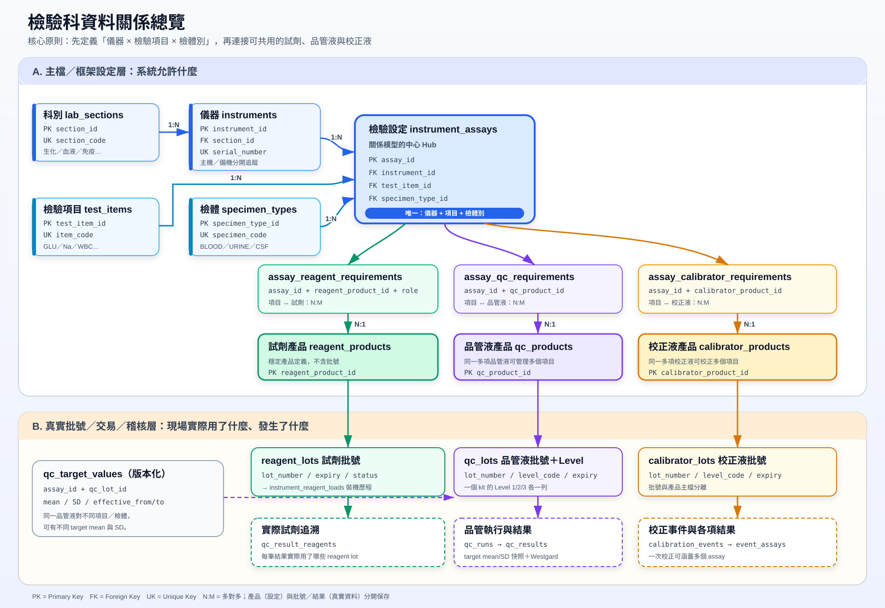

# MCP_PJQAQC

讓 AI 助理認識 PJQAQC 檢驗科品管資料庫的 MCP server。它知道完整的資料庫架構，能依問題找到對應的工具與資料，而且只會讀取、不會修改資料。



## 它能回答什麼

| 你問 | 使用的工具 |
|---|---|
| 「這個資料庫的架構是什麼？」「qc_results 怎麼串到 reagent_products？」 | `get_schema_overview`、`describe_table`、`find_join_path` |
| 「XN-3000 有做哪些項目？」「GLU 要用哪些試劑和品管液？」 | `find_assays` |
| 「Ci-Trol 用在哪些項目？」 | `get_product_usage` |
| 「哪些試劑快過期？」「還有哪些品管液沒平測？」 | `find_lots` |
| 「WBC 上週的品管結果？」「有哪些違反 1-3s？」 | `get_qc_results` |
| 「上個月失控幾次？CV 多少？」 | `get_qc_summary` |
| 「GLU 目前的 mean 和 SD？」 | `get_qc_targets` |
| 「c503 現在機上裝哪批試劑？」 | `get_loaded_reagents` |
| 「批號 11223 影響了哪些結果？」 | `trace_reagent_lot` |
| 「這筆結果當時為什麼判 FAIL？」 | `trace_qc_result` |
| 「WBC 上次校正是什麼時候？」 | `get_calibration_history` |
| 其他無法歸類的問題 | `run_readonly_query`（受檢查的自訂 SELECT） |

不確定從哪裡開始時，AI 會先呼叫 `route_question`：它分析問題，回傳該用的工具、建議參數，以及辨識到的項目、儀器、檢體與批號。支援常用中文名，例如「血糖」對應 GLU、「血液組」對應 HEM。另外還有 `search_entities` 可模糊搜尋主檔，`check_connection` 可檢查連線與結構是否一致。

架構也以 MCP resource 提供：`pjqaqc://schema/overview`、`pjqaqc://schema/tables/{table}`。

## 安裝

需要 Python 3.10 以上。

```bash
git clone https://github.com/Henry4234/MCP_PJQAQC.git
```

```bash
cd MCP_PJQAQC
```

```bash
python -m venv .venv
```

```bash
.venv\Scripts\python -m pip install -e .
```

## 設定資料庫連線

本專案**只連 MariaDB 本地測試庫**，不含 PostgreSQL 驅動，因此無法連到 Supabase 正式庫。連線設定使用和 PJQAQC backend 相同的 `MYSQL_*` 名稱，有兩種方式：

- 複製 `.env.example` 為 `.env` 後填入帳密。`.env` 已被 `.gitignore` 排除。
- 設定環境變數 `PJQAQC_ENV_FILE`，指向既有的設定檔，例如 `E:/python/PJQAQC/backend/.env`。

只查架構的工具（`get_schema_overview`、`describe_table`、`find_join_path`）不需要連線。

## 接到 Claude

Claude Code：

```bash
claude mcp add --transport stdio --env PJQAQC_ENV_FILE=E:/python/PJQAQC/backend/.env pjqaqc -- E:/path/to/MCP_PJQAQC/.venv/Scripts/python.exe -m mcp_pjqaqc
```

Claude Desktop 的 `claude_desktop_config.json`：

```json
{
  "mcpServers": {
    "pjqaqc": {
      "command": "E:/path/to/MCP_PJQAQC/.venv/Scripts/python.exe",
      "args": ["-m", "mcp_pjqaqc"],
      "env": { "PJQAQC_ENV_FILE": "E:/python/PJQAQC/backend/.env" }
    }
  }
}
```

## 唯讀如何保證

共有四道防護，任何一道都不依賴 AI 的判斷：

1. **資料庫交易**：每條語句都在 `START TRANSACTION READ ONLY` 內執行，結束一律 rollback。伺服器會拒絕寫入（錯誤 1792）。
2. **SQL 檢查**：`run_readonly_query` 先解析語法，只接受單一 SELECT、只能查 PJQAQC 的表與 View，並拒絕 `INTO OUTFILE`、`FOR UPDATE`、`@` 變數、跨資料庫查詢，以及 `LOAD_FILE`、`SLEEP` 等函式。
3. **重新產生 SQL**：實際執行的是解析後重新產生的語句，MariaDB 會執行的 `/*! ... */` 註解不會被送到伺服器。
4. **資源上限**：單句 15 秒逾時，回傳筆數有上限。

**建議另外建立專用唯讀帳號。** 目前 backend 使用的帳號對 `PJQAQC` 有完整權限。請由管理員執行 [sql/create_readonly_user.sql](sql/create_readonly_user.sql)，再把帳密填入 `.env`。設定後 `check_connection` 的 `account_can_write` 應為 `false`。

## 架構如何保持正確

- `src/mcp_pjqaqc/schema_snapshot.json`：從資料庫 `information_schema` 產生的結構快照，含欄位、型別、外鍵與允許值。
- `src/mcp_pjqaqc/knowledge.py`：資料庫無法提供的語意，含中文說明、分層、業務規則與同義詞。

`check_connection` 會比對快照與線上結構。若回報 `in_sync: false`，代表資料庫已變更，請更新快照，並為新表補上說明：

```bash
python -m mcp_pjqaqc.snapshot
```

## 開發與測試

```bash
.venv\Scripts\python -m pip install -e ".[dev]"
```

不連資料庫的測試：

```bash
.venv\Scripts\python -m pytest -m "not database"
```

連本地測試庫的測試（全程唯讀）：

```powershell
$env:PJQAQC_ENV_FILE="E:/python/PJQAQC/backend/.env"; .venv\Scripts\python -m pytest
```

## 目前的限制

- 本地測試庫的 `qc_runs`、`qc_results`、校正與裝機紀錄目前都是空的。這些工具的 SQL 已在真實結構上驗證可執行，結果整理邏輯以模擬資料測試，但還沒有用真實品管資料跑過。
- 工具在資料表為空時會明確說明「尚未登錄」，避免被解讀成「沒有異常」。
- 只支援 stdio 傳輸，供本機 MCP client 使用；沒有提供網路存取或驗證機制。
